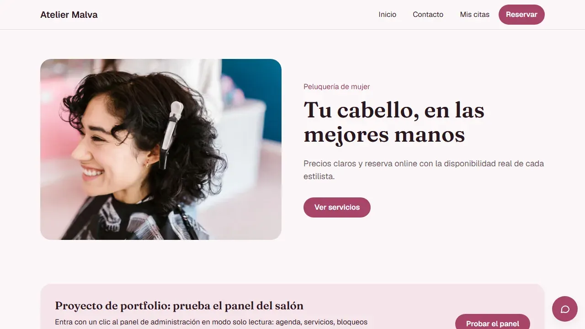
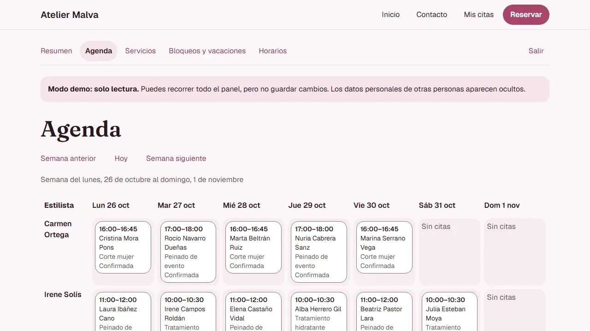

# Atelier Malva — reservas para una peluquería (demo de portfolio)

Web de reservas de una peluquería de mujer con **disponibilidad en tiempo real**, cuentas de clienta, **panel de administración** y
privacidad pensada desde el diseño. El salón es ficticio: es un proyecto de portfolio, construido con *Spec-Driven Development*.



- **Demo en vivo:** https://estudio-peluqueria.vercel.app — pulsa «Probar el panel» para entrar al panel de administración en modo solo lectura.
- **Portfolio:** https://terryq.com

## Funcionalidades

- **Reserva sin doble reserva**: elige servicio, estilista, día y hora; la disponibilidad se actualiza en vivo y la BD garantiza que una
  estilista no tenga dos citas solapadas (restricción de exclusión + función transaccional).
- **Gestión de la cita sin cuenta o con cuenta**: enlace personal por email (solo se guarda su huella) para ver, cambiar o cancelar;
  cuentas de clienta por enlace mágico, sin contraseña, con «Mis citas».
- **Panel de administración**: agenda semanal por estilista, mover y cancelar citas con aviso por email, servicios, horarios y bloqueos o vacaciones.
- **Demo segura**: cuenta de **solo lectura** impuesta por la base de datos (RLS) que ve las citas de visitantes **enmascaradas** («María G.»).
- **Privacidad**: borrado y anonimización a petición, límites antiabuso por email e IP (solo huellas con caducidad) y páginas que cuentan qué se guarda.
- **Accesibilidad y responsive**: WCAG AA como suelo, probado de 320 a 1280 px, galería antes/después con imágenes generadas con IA (señalizadas).



## Stack

| Capa | Tecnología | Por qué |
|---|---|---|
| Web | Next.js 16 (App Router), React 19, TypeScript estricto | Servidor por defecto, formularios con acciones de servidor |
| Estilos | Tailwind CSS 4 con tokens y paleta validada (contraste WCAG AA) | Sin colores sueltos en componentes |
| Datos y auth | Supabase (Postgres, Auth, Realtime) con RLS en todas las tablas | La seguridad vive en la BD, no en la interfaz |
| Validación | Zod en cada entrada externa | Tipos derivados del esquema |
| Emails | Adaptador intercambiable (Mailpit en local, Resend en producción) | Mismo código en ambos entornos |
| Calidad | Vitest, Playwright, axe, gitleaks, GitHub Actions | Cada criterio de aceptación tiene un test o una comprobación documentada |
| Despliegue | Vercel y Supabase alojado | |

## Arquitectura en una mirada

```
src/app/          rutas (reserva, cuenta, panel /admin, páginas de demostración y privacidad)
src/lib/          dominio: disponibilidad, reserva, cuenta, panel, privacidad, demo, emails
src/components/   interfaz compartida (cabecera, pie, chat de ayuda, avisos)
supabase/         migraciones (esquema, RLS y funciones con security definer) y semilla ficticia
scripts/          utilidades en Node, multiplataforma (admin:promote, demo:seed, keep-alive…)
tests/            unitarios, de integración contra Supabase local y e2e con Playwright
sdd/              especificación, plan, ADR, tareas y reviews con evidencia (el método de trabajo)
docs/             constitución del proyecto, guía de publicación, registro de imágenes
```

Decisiones destacadas (en `sdd/adrs/`): token de gestión de cita solo como huella, estados de la cita, anonimización en lugar de borrado,
cuenta demo de solo lectura con enmascarado en la BD (ADR-0036) y keep-alive diario de Supabase (ADR-0037).

## Cómo ejecutarlo en local

Requisitos: Node 24, pnpm 9, Docker y la [CLI de Supabase](https://supabase.com/docs/guides/cli) (versión 2.118).

```bash
pnpm install
supabase start                     # Supabase local con migraciones y semilla
cp .env.example .env.local         # rellena las variables con los valores de `supabase status`
pnpm dev                           # http://localhost:3000
```

| Comando | Qué hace |
|---|---|
| `pnpm typecheck` · `pnpm lint` | Tipos y estilo |
| `pnpm test` | Tests unitarios |
| `pnpm test:integration` | Integración contra el Supabase local (RLS, reservas, privacidad) |
| `pnpm test:e2e` | Flujos completos y barrido responsive de 18 anchos |
| `pnpm test:a11y` | axe sobre las páginas públicas |
| `pnpm db:reset:local` | Deja la BD local con la semilla |
| `pnpm admin:promote <email> --local` | Da el rol de administración a una cuenta |
| `pnpm demo:seed --local` | Citas, vacaciones y bloqueos de ejemplo |

Las variables de producción (Supabase, Resend y la demo) están en [`docs/publicacion.md`](docs/publicacion.md). Ninguna clave se versiona.

## Estado

Funcionalmente completo: 33 tareas cerradas con su review y evidencia (480 tests unitarios, 255 de integración y 1130 e2e a 24 de octubre de 2026).
Es una demo: el salón, sus datos, las citas y las imágenes de la galería son ficticios. Las páginas
[Aviso de demostración](https://estudio-peluqueria.vercel.app/aviso-legal) y [Privacidad](https://estudio-peluqueria.vercel.app/privacidad)
describen lo que guarda. No es asesoramiento legal.

## Licencia

[MIT](LICENSE). La foto de portada es de RDNE Stock project, en [Pexels](https://www.pexels.com/photo/curly-haired-woman-with-crocodile-hair-clip-7755215/).
